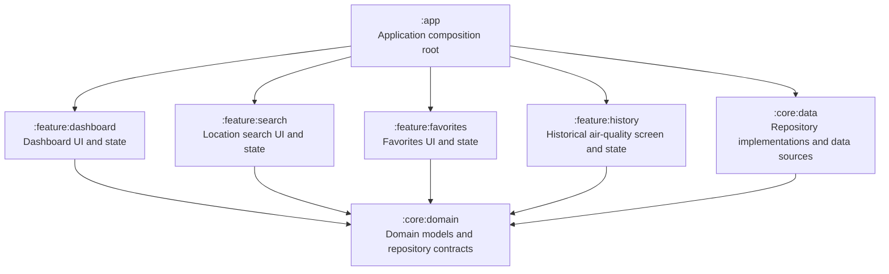
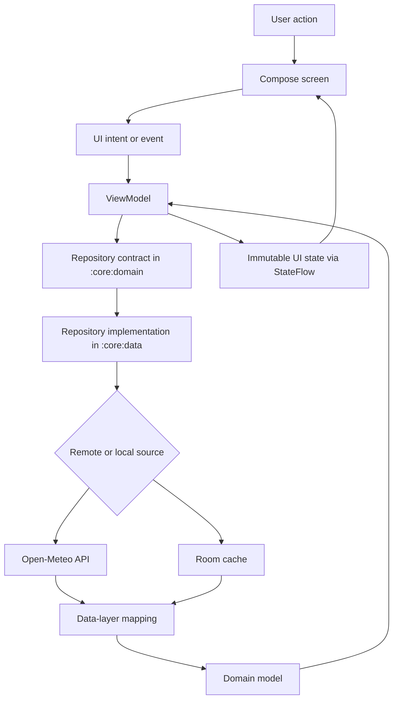
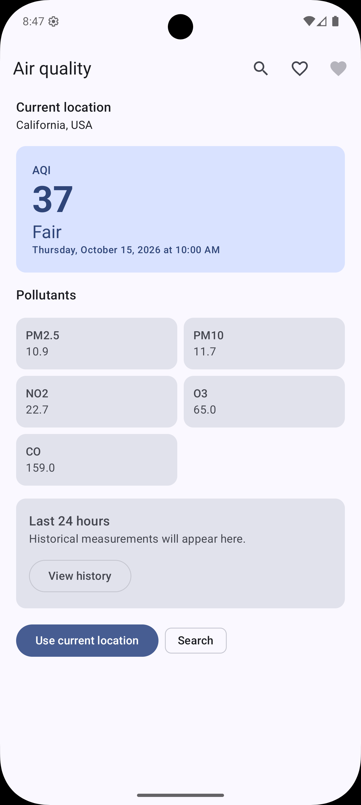
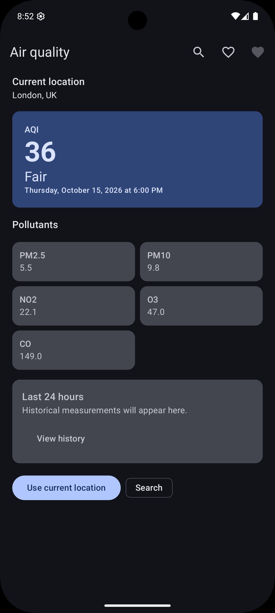
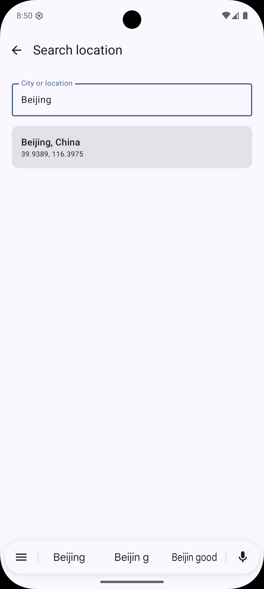
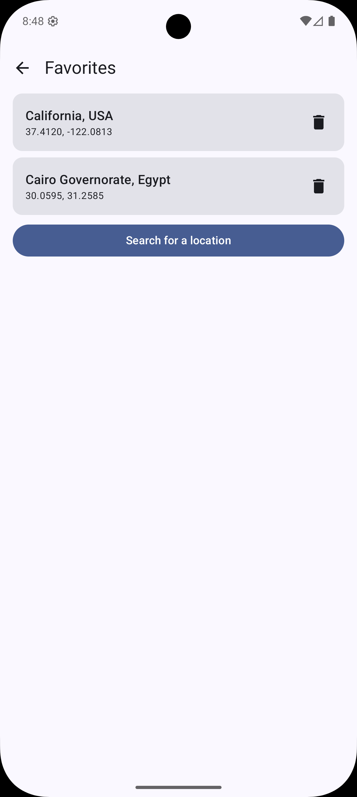
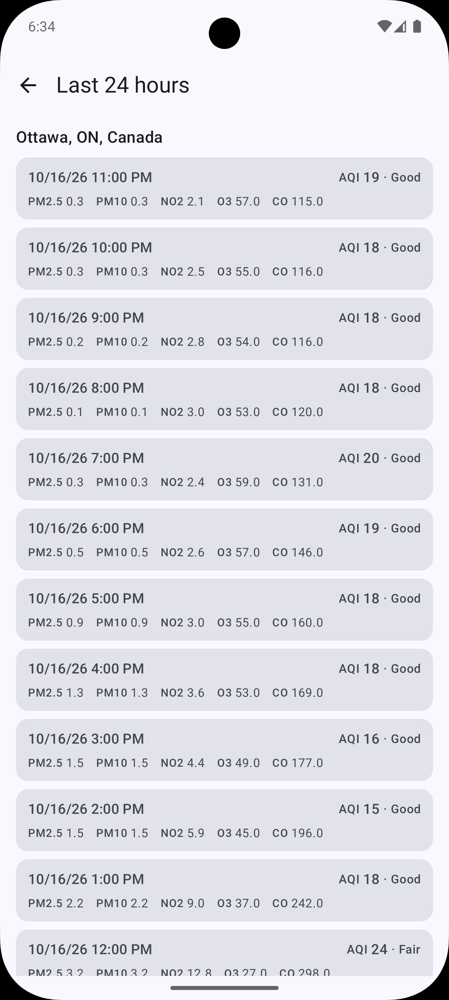

# Air Quality Monitor

An Android application in active development that helps users understand current and recent air-quality measurements for a selected location. The project emphasizes clear presentation, privacy-conscious local favorites, reliable data handling, and explicit communication when measurements may be outdated or unavailable.

## Overview

The intended product experience brings together current air-quality information and recent measurements in one place. Users can use their device location when they grant permission or search for a place by name. Location permission is optional; searching for a location should remain available when permission is denied.

## Product scope

- **Current air quality:** AQI, its category, measurement time, and supported pollutant readings such as PM2.5, PM10, NO₂, O₃, and CO.
- **Location selection:** Use the device's location when permitted or search for a location by name.
- **Favorites:** Save locations locally without requiring an account.
- **Recent history:** Display the last 24 hours of hourly measurements when sufficient data is available from the data source.
- **Caching and offline behavior:** Keep recently retrieved measurements available when possible. Cached data is considered fresh for up to 30 minutes after retrieval; older data is marked stale.
- **Resilient refresh behavior:** If a remote refresh fails but a cached snapshot exists, keep displaying that snapshot and communicate the refresh failure separately, with a retry action where appropriate.
- **Clear exceptional states:** Handle loading, missing measurements, permission denial, empty search results, network/API failures, and offline use without hiding useful data unnecessarily.

This repository is being developed incrementally. For phase status and acceptance criteria, see [`docs/development-plan.md`](docs/development-plan.md).

## Technology stack

- **Language:** Kotlin
- **UI:** Jetpack Compose and Material 3
- **Presentation:** ViewModel, immutable UI state, Kotlin Coroutines, Flow, and StateFlow using unidirectional data flow (MVI-style)
- **Dependency injection:** Hilt
- **Networking:** Retrofit and OkHttp
- **Data sources:** Open-Meteo Air Quality API and a Distance Matrix geocoding service
- **Local persistence:** Room
- **Testing:** JUnit, MockK, Android instrumented tests, and Compose UI testing
- **Build system:** Gradle with Kotlin DSL and a centralized version catalog

## Architecture

The project uses a layered architecture with feature-oriented presentation modules. Domain contracts are separated from infrastructure implementations, and `:app` acts as the composition root.

### Module dependency graph

The arrows below mean **“depends on”**, rather than runtime data flow.



Key boundaries:

- `:app` assembles the application and owns app-level wiring, navigation, and dependency-injection configuration.
- Feature modules depend on `:core:domain`, not on other feature modules or directly on `:core:data`.
- `:core:domain` defines app-owned domain models and repository contracts without depending on Retrofit or Room.
- `:core:data` implements domain repository contracts and owns API/DTO handling, data mapping, persistence, and remote/local data coordination.
- Composables render UI state and emit user actions; they do not access repositories, DAOs, or network APIs directly.

### Intended air-quality data flow



### Module responsibilities

| Module | Responsibility |
| --- | --- |
| `:app` | Application entry point, navigation, dependency-injection setup, and composition root |
| `:core:domain` | Shared domain models, repository contracts, and domain rules |
| `:core:data` | Repository implementations, API integration, DTOs, mappers, Room persistence, and cache coordination |
| `:feature:dashboard` | Current air-quality dashboard and its presentation logic |
| `:feature:search` | Location search and selection UI and its presentation logic |
| `:feature:favorites` | Favorite-location UI and its presentation logic |
| `:feature:history` | Historical air-quality screen and its presentation logic |

## Getting started

### Prerequisites

- Android Studio with support for the Android Gradle Plugin version used by this project
- A compatible JDK for the project's Gradle wrapper
- The Android SDK platform required by the project's configured `compileSdk`

### Clone the repository

```bash
git clone https://github.com/Yasserkhayyal/air-quality-monitor.git
cd air-quality-monitor
```

Open the project in Android Studio and allow Gradle sync to finish.

### Build the debug app

```bash
./gradlew assembleDebug
```

The debug APK is normally generated under `app/build/outputs/apk/debug/`.

## Verification

Run unit tests:

```bash
./gradlew test
```

Run Android Lint:

```bash
./gradlew lint
```

Run the `:core:data` instrumented tests on a connected emulator or device:

```bash
./gradlew :core:data:connectedDebugAndroidTest
```

Instrumented tests require an available Android emulator or physical device. Some focused module-level verification tasks may also be used during development; see the Gradle task names and the phase-specific instructions when working on a particular feature.

## Data source

Air-quality measurements are sourced from the [Open-Meteo Air Quality API](https://open-meteo.com/en/docs/air-quality-api). Location lookup uses a geocoding service [Distance Matrix Geocoding API](https://distancematrix.ai/geocoding-api). External API response types are kept in the Data layer and mapped to app-owned domain models before reaching the presentation layer.

## Development approach

Work is organized into incremental phases so each phase can be built and tested before moving to the next. The repository's design and implementation rules are documented in:

- [`docs/product-spec.md`](docs/product-spec.md) — product requirements and user-visible behavior
- [`docs/architecture.md`](docs/architecture.md) — layers, module boundaries, and dependency direction
- [`docs/development-plan.md`](docs/development-plan.md) — phase sequence, scope, and definitions of done
- [`.github/copilot-instructions.md`](.github/copilot-instructions.md) — coding conventions and AI-assisted development constraints

## Screenshots

<table>
  <tr>
    <th>Dashboard</th>
    <th>Dashboard Dark Theme</th>
    <th>Location search</th>
    <th>Favorites</th>
    <th>History</th>
  </tr>
  <tr>
    <td></td>
    <td></td>
    <td></td>
    <td></td>
    <td></td>
  </tr>
</table>

## Demo

<p style="text-align: center;">
  <a href="docs/assets/demo/demo.webm">
    
  </a>
</p>

<p style="text-align: center;">
  <a href="docs/assets/demo/demo.webm">Watch the full screen recording (WebM)</a>
</p>
